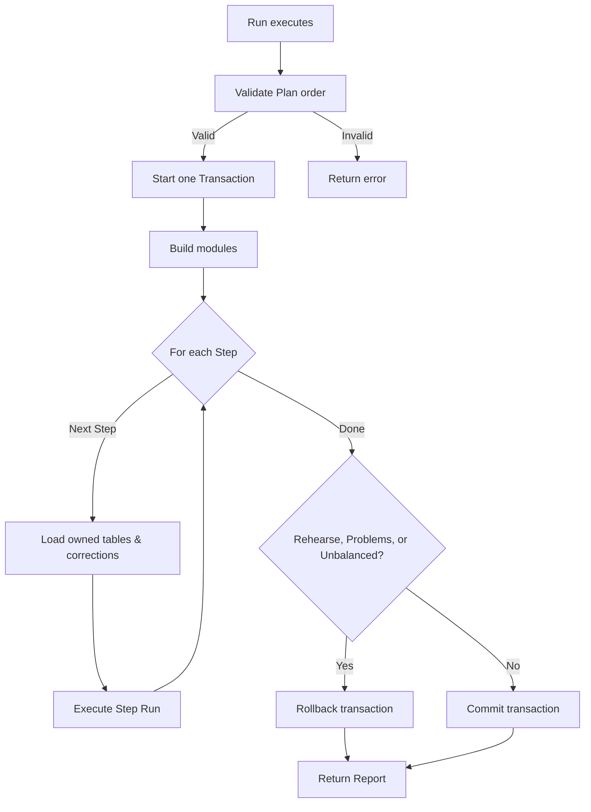

# Run Flow

## Walkthrough

1. The plan execution order is evaluated. Missing steps, cyclic dependencies, missing targets, or duplicated owned tables are flagged.
2. A single database transaction is created to hold all operations.
3. Models and utilities provided via `Plan.Build` are initialized using the active transaction.
4. For each selected and dependent step, we load legacy data via the `ddl.Snapshot`. Applicable fixes from `Corrections` are overlaid onto the legacy values.
5. The `Step.Run` function takes over, performing logic and issuing `Report` calls for each row (Imported, Merged, Discarded, Problem, etc).
6. Once all steps resolve, the final state is checked. If it's a `Rehearse` mode, or the report has problems, or it's out of balance (where Source != Imported + Merged + Discarded), the transaction is rolled back.
7. Otherwise, the transaction is committed, leaving the imported data intact on the database.
